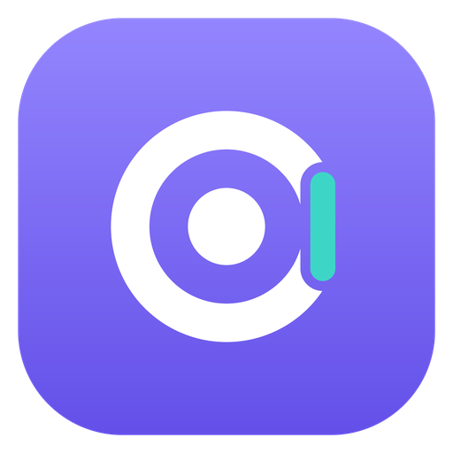

# ReelLens — downloads

ReelLens turns any video or audio file into **subtitles**, **tags against your own criteria sheet**, and a
**timestamped quality review**. It runs on your own computer: free, private, and offline once models are downloaded.

## Download

Go to **[Releases](../../releases/latest)** and pick:

| Your computer | File |
|---|---|
| Windows 10/11 (64-bit) | `ReelLens-Setup-x.y.z.exe` |
| Mac with Apple Silicon (M1–M4) | `ReelLens-x.y.z-macos-arm64.dmg` |

## Install

- **Windows:** run the installer (no admin rights needed). If you see *"Windows protected your PC"*, click
  **More info → Run anyway**. The app isn't code-signed, which is normal for free apps.
- **Mac:** open the `.dmg` and drag **ReelLens** into **Applications**. On first launch, right-click → **Open**, or go to
  **System Settings → Privacy & Security → Open Anyway**.

## Optional: free local AI

Install **[Ollama](https://ollama.com/download)**, then in ReelLens open **Settings → Local AI → Download**.
Without it you still get subtitles, measured checks and demo mode, or you can add your own OpenAI, Anthropic or Gemini key.

## Privacy

- Your files never leave your computer. Uploads are auto-deleted after 24 hours (adjustable).
- API keys (optional) are kept in your operating system's keychain and sent only to the provider they belong to.
- No telemetry.

Built with ❤️ & claude code by Aryan Rai
